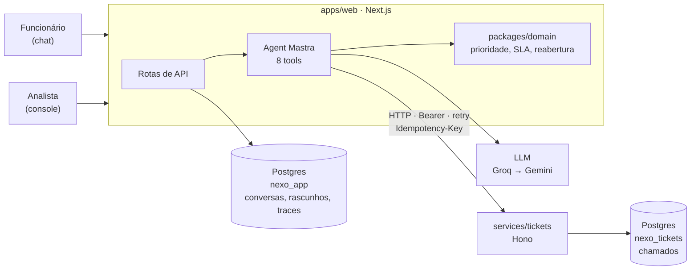
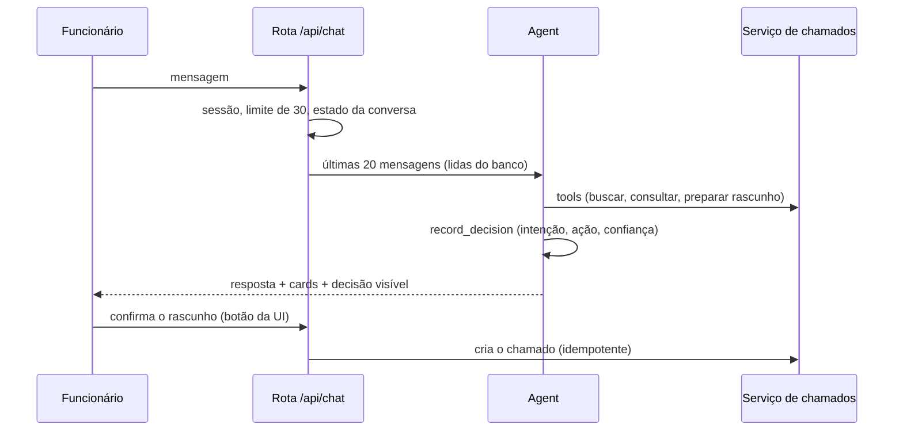
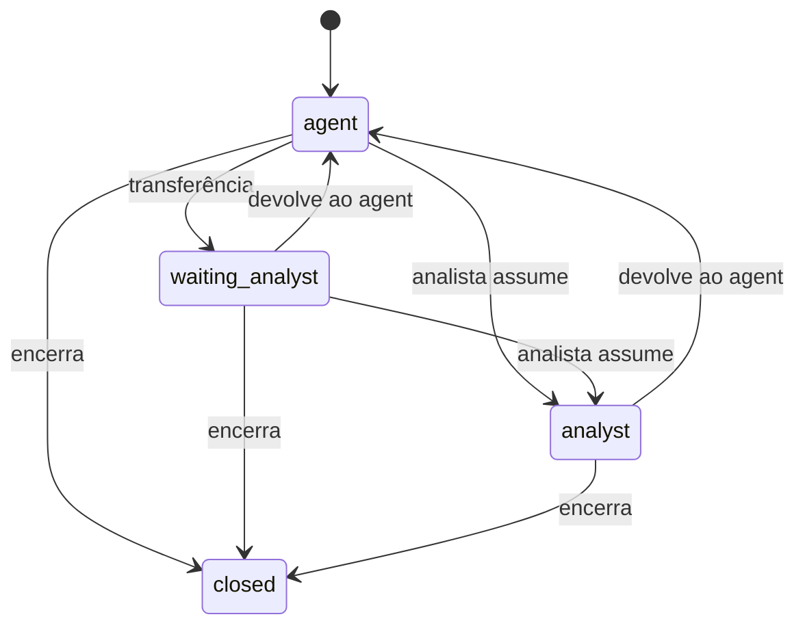

# Nexo Assist

**Assistente de service desk de TI em chat.** O funcionário descreve o problema e um agent de IA resolve pela central de ajuda, consulta, abre ou atualiza chamados, e passa a conversa para um analista humano quando precisa.

[](https://github.com/gustavo-hf-simoes/nexo-assist/actions/workflows/ci.yml)
[](https://github.com/gustavo-hf-simoes/nexo-assist/actions/workflows/deploy.yml)

**Demo:** https://nexo-assist-amber.vercel.app

Stack: TypeScript strict · Next.js 16 · Mastra · Hono · PostgreSQL · Vitest, Testcontainers e Playwright · Vercel + Neon · GitHub Actions

---

## Testar em 2 minutos

Entre com qualquer senha não vazia. Para ver os dois lados ao mesmo tempo, abra o funcionário numa janela normal e o analista numa janela anônima.

| Perfil | E-mail | O que testar |
|---|---|---|
| Funcionária | `ana.souza@nexo.com.br` | "A VPN dá erro 809 no Windows 11" (abre rascunho de chamado) · "Como está meu chamado do notebook?" (chamado vencido, oferece analista) · "Quero falar com um analista" |
| Analista | `rafael.lima@nexo.com.br` | Abrir a conversa da Ana no console · **Assumir** (o agent pausa) · responder · **Devolver ao agent** ou **Encerrar** |

A demo usa cota gratuita de LLM, com limite diário de turnos e de 30 mensagens por sessão (ver [Modelo e custo](#modelo-e-custo)).

## Destaques

- **Regras fora da LLM.** Prioridade, prazo (SLA em horário útil), duplicidade, reabertura e privacidade são calculados em código ([`packages/domain`](packages/domain)). A LLM só informa os fatos.
- **O chamado só nasce pela UI.** O agent monta um rascunho e o funcionário confirma. A criação é idempotente (`Idempotency-Key = draft.id`): confirmar duas vezes gera no máximo um chamado.
- **A decisão fica visível.** Cada resposta mostra o que o agent entendeu, a ação, a confiança e a justificativa.
- **O analista tem o controle.** Ele pode assumir qualquer conversa; o agent pausa na hora, mesmo no meio de um turno.
- **Privacidade.** O `employeeId` vem só da sessão. Chamado de outra pessoa responde "não encontrado".
- **Custo zero.** Modelos do plano gratuito, sem billing ativo, com limites contra abuso.

## Arquitetura



O app e o serviço de chamados são **processos e bancos separados**. Conversas, chamados e o estado de cada conversa sobrevivem a reinício.

| Pasta | Responsabilidade |
|---|---|
| [`apps/web`](apps/web) | Chat, console do analista, rotas de API e agent |
| [`services/tickets`](services/tickets) | Serviço de chamados simulado, com falha injetável para exercitar o retry |
| [`packages/domain`](packages/domain) | Regras de negócio puras: tipos, categorias, prioridade, SLA, reabertura |

## Como o agent decide



**Tools:** `search_my_tickets`, `get_ticket`, `search_help_center`, `classify_priority`, `prepare_ticket_draft`, `present_choices`, `handoff_to_analyst`, `record_decision`.

**Quando a conversa vai para o analista:** quando o funcionário pede, em caso crítico, em chamado vencido ou quando a confiança fica abaixo de 0.6. A transferência leva um resumo do caso.



Enquanto a conversa está em `waiting_analyst` ou `analyst`, o agent não responde.

## Qualidade

| Camada | O que cobre | Onde |
|---|---|---|
| Unitários | Regras de domínio, tools, mapeamento do chat, componentes. O agent roda sem rede, com um modelo roteirizado | `apps/web/tests/unit`, `packages/domain/tests`, `services/tickets/tests` |
| Integração | Repositórios e serviço de chamados contra Postgres real (Testcontainers): idempotência, privacidade, estados da conversa | `apps/web/tests/integration` |
| E2E | Fluxo completo do chat e do console no navegador (Playwright) | [`apps/web/tests/e2e`](apps/web/tests/e2e) |
| Esteira | Lint, typecheck, build, termos proibidos, hooks. O deploy só roda se tudo passar | [`.github/workflows`](.github/workflows) |

### Eval: as decisões do agent contra o modelo real

Os 12 cenários de [`apps/web/evals/scenarios.ts`](apps/web/evals/scenarios.ts) conferem as tools chamadas, os argumentos, o rascunho, a transferência e o texto da resposta.

**Resultado: 9 de 12 (75%)**, numa rodada completa em 19/11/2026, com uma média de 9.773 tokens por cenário. O relatório gerado pela ferramenta, com tokens e tempo por cenário, está em [`apps/web/evals/report.md`](apps/web/evals/report.md).

| Cenário reprovado | Causa | Correção |
|---|---|---|
| 05: chamado vencido do notebook | Respondeu com a busca, sem `get_ticket` (que traz o prazo) | Regra: status sempre por `get_ticket` |
| 07: senha do SAP bloqueada de novo | Não montou o rascunho de reabertura | Regra: reabrir sem pedir confirmação antes |
| 08: Outlook sem sincronizar | Categoria `Software` em vez de `E-mail` | Exemplos por categoria nas instruções |

As três correções estão no commit [`864f28f`](https://github.com/gustavo-hf-simoes/nexo-assist/commit/864f28f), com testes. Depois delas, o cenário 05 passou numa rodada isolada. **A rodada completa não foi repetida, por escolha.** Cada rodada gasta cerca de 117 mil tokens, mais da metade da cota diária gratuita, e a chave é a mesma da demo. O PRD não pede eval; ele foi usado como ferramenta de calibragem. Por isso não roda no CI nem no deploy, só à mão:

```bash
npm run eval -w @nexo/web            # rodada completa, regrava o report.md
npm run eval -w @nexo/web -- --only "VPN"   # só os cenários com o trecho no nome
```

## Modelo e custo

| Item | Escolha |
|---|---|
| Modelo | Uma cadeia de modelos gratuitos da Groq (`gpt-oss-120b` → `qwen3.8-27b` → `gpt-oss-20b`), com `gemini-3.5-flash-lite` como último recurso. Se um devolve 429, o próximo responde |
| Troca de modelo | Só a variável `NEXO_AGENT_MODEL`, sem mudar código ([ADR 0007](docs/adr/0007-cadeia-de-modelos-gratuitos.md)) |
| Custo | Zero: nenhum provedor tem billing ativo |
| Proteção | Limite diário de turnos e de 30 mensagens por sessão, guardados no banco, e rate limit de login |

Os limites existem porque a demo usa cota gratuita. Em produção, basta trocar a chave por uma de modelo pago e ajustar ou remover os limites pelas variáveis de ambiente.

## Rodar localmente

Pré-requisitos: Node 22.9 ou superior, Docker e npm.

```bash
npm ci
cp .env.example .env      # preencha GROQ_API_KEY e/ou GOOGLE_GENERATIVE_AI_API_KEY, e SESSION_SECRET (32+ caracteres)
npm run db:up             # Postgres no Docker
npm run db:migrate        # os dois bancos
npm run db:seed           # usuários, artigos e chamados de exemplo
```

Em dois terminais:

```bash
npm run dev -w @nexo/tickets   # serviço de chamados
npm run dev -w @nexo/web       # http://localhost:3000
```

| Comando | O que faz |
|---|---|
| `npm run lint \| typecheck \| test \| build` | Qualidade em todos os workspaces |
| `npm run test:integration` | Integração com Testcontainers (precisa de Docker) |
| `npm run e2e` | Playwright (antes: `npx playwright install chromium`) |

Se a porta 5432 estiver ocupada, defina `POSTGRES_PORT=5433` e troque a porta nas URLs do `.env`.

### Dados de exemplo

9 usuários, 9 artigos da central de ajuda e 7 chamados em situações variadas: aberto, vencido, resolvido há poucos dias e de outros funcionários.

| Id (`<id>@nexo.com.br`) | Perfil |
|---|---|
| ana.souza, carla.mendes, bruno.tavares, diego.ramos, elisa.prado, fabio.nunes, gabriela.rocha | Funcionários (Windows, macOS e Linux) |
| rafael.lima | Analista N1 |
| julia.castro | Analista N2 |

## Deploy

A web e o serviço de chamados ficam em dois projetos na Vercel, com Postgres no Neon. O GitHub Actions publica depois que a CI passa na `main`: migra, popula o banco e faz o deploy dos dois. Topologia, segredos e trade-offs estão em [docs/deploy.md](docs/deploy.md).

## Decisões e trade-offs

| Decisão | Por quê | Custo |
|---|---|---|
| Um agent com tools, busca full-text ([ADR 0001](docs/adr/0001-agent-unico-com-tools.md)) | Poucos artigos; RAG vetorial seria excesso | Não escala para uma base grande |
| Regras no domínio ([ADR 0002](docs/adr/0002-regras-deterministicas-fora-da-llm.md)) | Determinismo e testes sem LLM | Mais código que um prompt |
| Confirmação só pela UI ([ADR 0003](docs/adr/0003-confirmacao-so-pela-ui.md)) | A LLM nunca cria chamado sozinha | Um clique a mais |
| Histórico próprio no Postgres ([ADR 0005](docs/adr/0005-historico-proprio-sem-mastra-memory.md)) | Controle do que o modelo vê; o cliente nunca manda histórico | Janela de 20 mensagens |
| Serviço de chamados separado ([ADR 0006](docs/adr/0006-servico-de-chamados-separado-e-resiliente.md)) | Simula o legado instável, com retry e idempotência | Dois processos para subir |
| Polling em vez de WebSocket | Simples e compatível com serverless | Alguma latência |
| Login de demonstração | O PRD aceita qualquer senha | Não serve para produção |
| SLA sem feriados | Fora do escopo do PRD | Prazos em feriados ficam curtos |

## Próximos passos

- Repetir o eval completo com uma chave separada da demo e manter a meta de 90% ou mais.
- Avaliar o OpenRouter com vários modelos gratuitos, mantendo só os que passarem num corte de precisão no eval.
- Medir tokens e custo reais por conversa em produção.
- SSO e rate limit compartilhado (Redis ou banco).
- SSE ou WebSocket no lugar do polling, e calendário de feriados no SLA.
